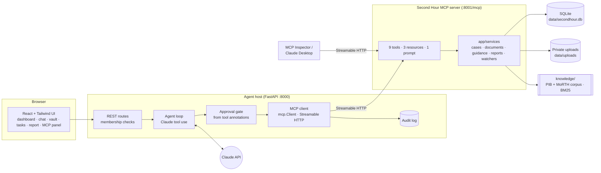

# Second Hour

**An MCP-powered case coordinator for Indian families in the hours and days after a road accident.**

wHACKiest 2026 · Track 1: *"Make MCP Matter": AI Agents for Everyday Life*

> Second Hour is **not an emergency service**. In an emergency, call **112**.
> **Synthetic demo data only.** All names, bills and reports in this repo are fictional.

---

## The problem

After a road accident, the family has to handle hospital procedures, the government **PM-RAHAT** cashless treatment scheme, police follow-ups and paperwork. All of it is spread across stakeholders, and it lands at the worst possible moment.

PM-RAHAT gives cashless treatment up to **₹1.5 lakh per victim for up to 7 days** from the accident at designated hospitals ([PIB, 11 March 2026](https://www.pib.gov.in/PressReleasePage.aspx?PRID=2238637)). The process still depends on steps the family cannot see. As of 31 July 2026, **3,674 victims were discharged after no police response within the prescribed timelines** ([PIB, 12 August 2026](https://www.pib.gov.in/PressReleasePage.aspx?PRID=2298285)).

## What Second Hour does

- **One case workspace** shared by family members (demo: Priya, the coordinator, and Arjun, her brother).
- **An agent that remembers the case.** It answers PM-RAHAT questions **only from official sources, with citations**, and says so when it can't find an answer.
- **Document vault.** Upload bills and reports, and they are classified and their fields extracted. Every field stays **"Needs review"** until a family member confirms it.
- **Missing-documents checklist**, labelled "guidance, not a legal determination".
- **Two deterministic watchers**, plain code with no LLM guessing:
  1. **Cover window tracker.** Shows "Day X of 7" plus the user-confirmed hospital bills against ₹1,50,000. It alerts at ≥80% of the cover or from day 6.
  2. **Police authentication watcher.** Alerts if the family-entered status stays "requested by hospital" for more than 24h (48h if life-threatening). It is clearly labelled as **the hospital's and police's clock, not the family's**.
- **Human-approved actions.** The agent only *proposes* tasks, assignments and reports. They run after a family member clicks **Approve**.
- **A PDF case package** with the summary, timeline, document index (with SHA-256 hashes), fields, missing items, alerts and a "not legal advice" notice.
- **The MCP panel** shows the live server connection, the discovered tools, resources and prompts, and an audit log of every tool call.

## Architecture



- **All business logic lives in `app/services/`**. MCP handlers and REST routes call the same services.
- **The chat never bypasses MCP.** The agent discovers tools from the MCP server at the start of each turn and converts MCP schemas into Claude tool definitions. Tool names are not hardcoded in the prompt.
- **Approval policy comes from MCP tool annotations.** `readOnlyHint=true` tools run automatically. Writes with `idempotentHint=false` (`create_*`, `assign_*`, `generate_*`) become approval cards. `analyze_case_documents` is an idempotent write whose output is always "Needs review", so it runs on upload.
- **The host injects `actor_id` and `case_id`** from the logged-in session, and the LLM never sees or chooses them. Every tool also re-checks case membership server-side.

### MCP contract

| Tool | Approval | What it does |
|---|---|---|
| `create_accident_case` | ✅ | Creates a case; returns `case_id`, `case_number`, `status` |
| `get_case_summary` | read-only | Overview, milestones, document counts, open tasks, alerts, next steps |
| `search_pmrahat_guidance` | read-only | BM25 over the curated official corpus; snippets with title, URL and date, or "not found" |
| `analyze_case_documents` | auto | Classifies and extracts fields with confidence; saves them as "Needs review" |
| `get_missing_documents` | read-only | Present / missing / needs_review against a configurable checklist |
| `get_case_alerts` | read-only | Deterministic watchers; optional `now` to evaluate at another time |
| `create_followup_task` | ✅ | Creates a task; a due date needs a `due_source` |
| `assign_family_task` | ✅ | Both actor and assignee must be case members |
| `generate_case_report` | ✅ | Builds the PDF and returns a download reference |

Resources: `pmrahat://guidance/overview`, `secondhour://cases/{case_id}/timeline`, `secondhour://cases/{case_id}/checklist`.
Prompt: `accident_case_review`.

## Setup and run

Requirements: Python 3.11+, Node 20+.

```bash
# 1. Python deps
python -m venv .venv
# Windows: .venv\Scripts\activate   macOS/Linux: source .venv/bin/activate
pip install -r requirements.txt

# 2. Config
cp .env.example .env        # add ANTHROPIC_API_KEY (optional: offline fallback works without it)

# 3. Frontend deps
cd frontend && npm install && cd ..

# 4. Seed demo data (users, simulated case, synthetic PDFs in demo_assets/)
python -m scripts.seed

# 5. Start everything (MCP :8001, agent host :8000, UI :5173)
./start.sh                  # macOS/Linux/Git Bash
.\start.ps1                 # Windows PowerShell  (-Seed to reset)
```

Open **http://localhost:5173** (dev), or run `cd frontend && npm run build` and open **http://localhost:8000**, which serves the built UI.

You can also start each part manually:

```bash
python -m app.mcp_server                                  # MCP server  → http://localhost:8001/mcp
uvicorn app.api:app --port 8000                           # agent host  → http://localhost:8000
cd frontend && npm run dev                                # UI          → http://localhost:5173
```

Tests: `python -m pytest -q tests` (MCP discovery via an in-process MCP client, permissions, watchers, RAG).

### Without an API key

If `ANTHROPIC_API_KEY` is not set, the agent uses a **deterministic offline mode** that still calls every tool through the MCP client: guidance search with citations, checklist, and proposing tasks and reports. Document extraction for text PDFs is rule-based and needs no key. Images and scanned PDFs need the key, because they use Claude vision.

## Connect a second MCP host

**MCP Inspector**

```bash
npx @modelcontextprotocol/inspector
```

Choose **Transport: Streamable HTTP** and **URL: `http://localhost:8001/mcp`**, then click Connect. Call `get_case_summary` with `{"actor_id": "u_priya", "case_id": "case_demo"}`. You'll see the same live case as the web app. Changes made in the UI show up in Inspector, and the reverse is also true.

**Claude Desktop** (or any MCP host that supports remote Streamable HTTP servers): add a custom connector pointing at `http://localhost:8001/mcp`. For stdio-only hosts, use a bridge such as `npx mcp-remote http://localhost:8001/mcp`.

## Demo script (about 3 minutes)

1. `python -m scripts.seed`, then start. **Log in as Priya** and open case **SH-2026-0001** (Ravi K, Bengaluru, incident yesterday at 9:30 PM).
2. **Documents.** Upload `demo_assets/sample_hospital_bill.pdf` and `sample_medical_report.pdf`. They are classified and their fields extracted, all marked *Needs review*. Confirm **total amount ₹1,24,000**.
3. **Dashboard.** The cover tracker shows ₹1,24,000 of ₹1,50,000 (83%), and a **watcher alert** appears. Click **Propose task**, then **Approve**. `create_followup_task` runs through MCP.
4. Set **police authentication** to *Requested by hospital*. Click **Demo clock +25 h**, and the police watcher alert appears. It cites PIB and says this is the hospital's and police's clock, not the family's.
5. **Agent.** Ask *"Who starts police authentication, and is there anything I need to do?"*. The answer comes with PIB citations, and the agent mentions the new alerts first. Then ask *"Create a task for the alert"*, and an approval card appears.
6. **Tasks.** Assign the task to **Arjun** (`assign_family_task`). Switch user to Arjun, and he sees the same case.
7. **Report.** Generate and download the PDF case package.
8. **MCP tab.** Shows the live tool-call log, the 9 discovered tools and which ones need approval. Open **MCP Inspector** on `:8001/mcp` and call `get_case_alerts` to read the same live case from a second host.

## Safety

- A persistent banner reads: *"Second Hour is not an emergency service. In an emergency, call 112."*
- The agent never gives legal advice, decides eligibility, predicts compensation or what the family will pay, files anything with police, hospitals, insurers or the government, or invents deadlines or statistics.
- Scheme answers come only from retrieved official text, with citations. If there is no match, it says so.
- Uploaded documents are **untrusted data**. Text PDFs are parsed by deterministic rules, so no LLM reads them. Vision extraction uses a JSON-only prompt that tells the model to ignore instructions inside the file. Tool results from documents are wrapped as untrusted before the LLM sees them.
- Extracted fields stay "Needs review" until a human confirms them. Only confirmed bill totals feed the cover tracker.
- The police authentication status is labelled **user-provided, unverified** everywhere.
- Mutating tools need explicit human approval. Every MCP call is written to an audit log.
- Every REST route and MCP tool checks case membership server-side.
- Uploads are stored privately in `data/uploads/` (never served) with a SHA-256 hash. Reports are downloadable only by case members.

## Tech stack

Python 3.11+ · MCP Python SDK v2 (`mcp` 2.3, `MCPServer`, Streamable HTTP, `mcp.Client`) · FastAPI · SQLAlchemy + SQLite · Anthropic Claude (`LLM_MODEL`) · PyMuPDF · ReportLab · rank-bm25 · React 19 + TypeScript + Vite + Tailwind CSS v4.

## Repository map

```
app/
  mcp_server.py        MCP server: tools, resources, prompt
  api.py               Agent host (FastAPI): REST, chat, approvals, MCP panel
  agent/               llm.py (swappable LLM), mcp_client.py (MCP client + policy + audit), loop.py (agent)
  services/            cases & watchers, documents, guidance (BM25), reports (PDF)
knowledge/             Curated PM-RAHAT corpus with front-matter (title, publisher, url, date, last_reviewed)
scripts/seed.py        Demo users, simulated case, synthetic PDFs
demo_assets/           SAMPLE – SYNTHETIC DATA PDFs
frontend/              React app
tests/                 pytest suite
```

## Team Alpha

- **Anjankumar LN** (team leader)
- Kanishka S
- Gagandeep G
- Deekshith K

Ramaiah Institute of Technology · wHACKiest 2026 · Track 1

## Sources

- PIB, 11 March 2026: PM-RAHAT salient features. https://www.pib.gov.in/PressReleasePage.aspx?PRID=2238637
- PIB, 12 August 2026: implementation status as of 31 July 2026. https://www.pib.gov.in/PressReleasePage.aspx?PRID=2298285
- MoRTH Gazette S.O. 2489(E), 4 June 2025: summarised; only points cross-checked with PIB are included, and the rest is marked not verified.
