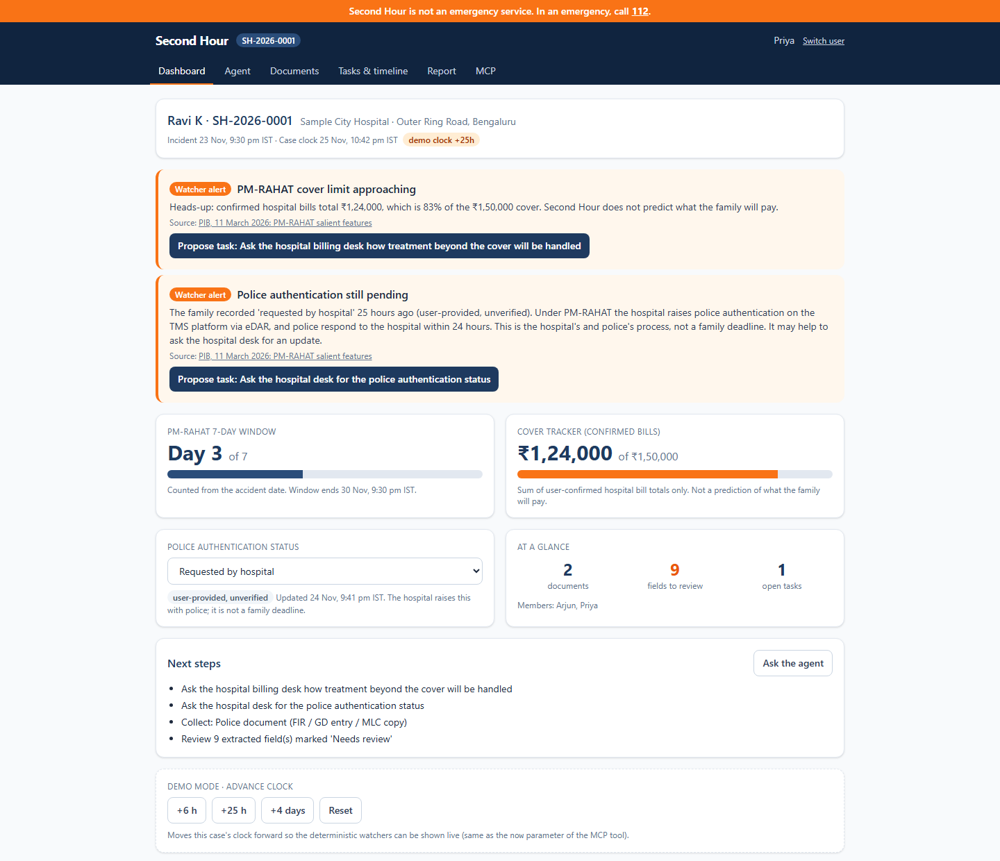
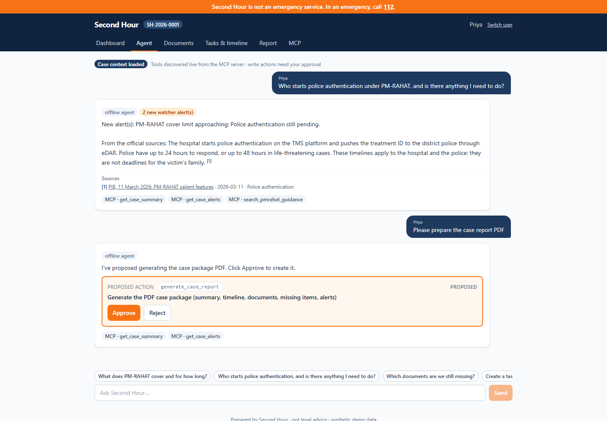
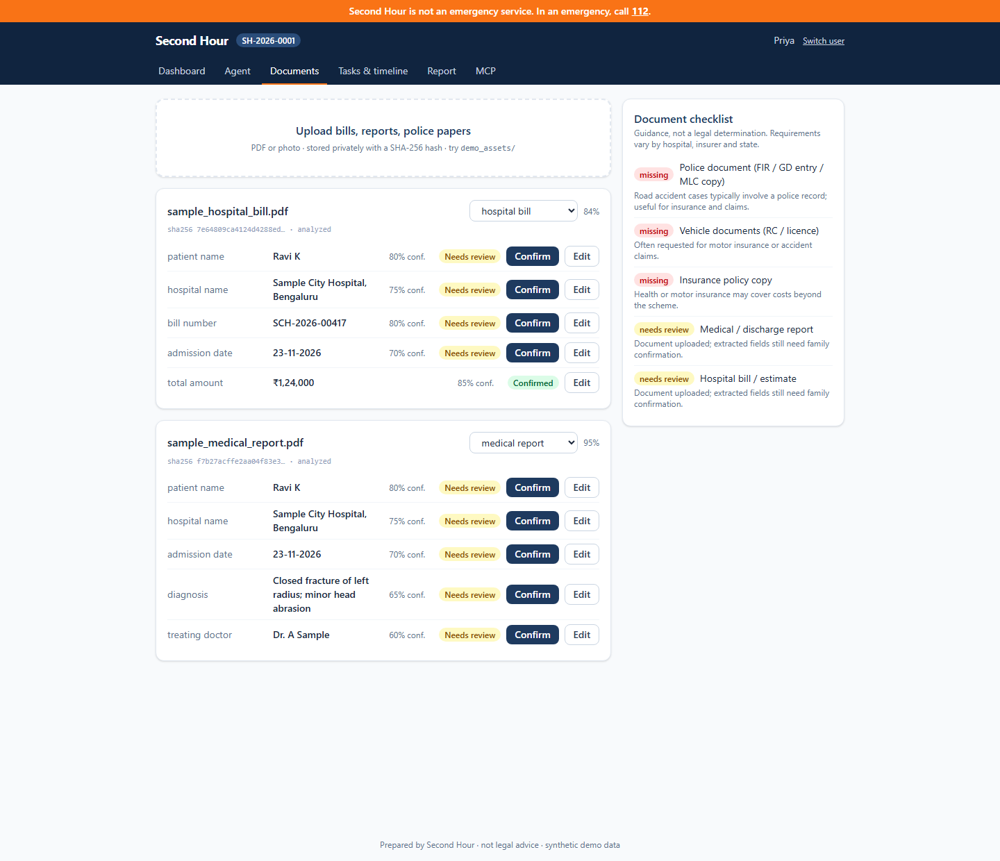
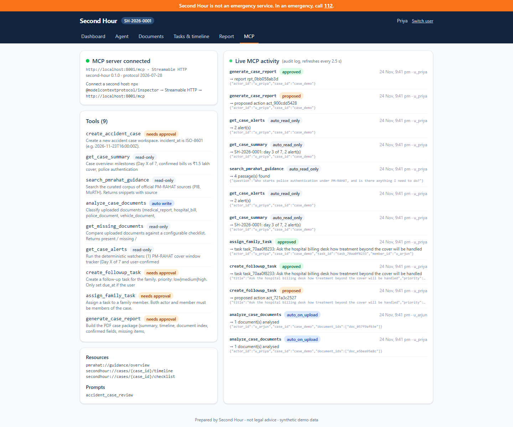
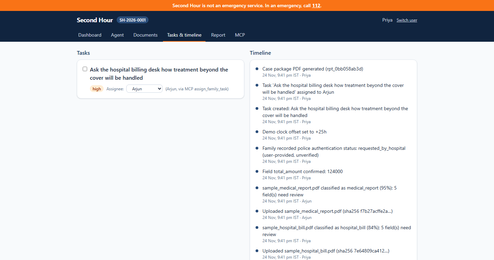
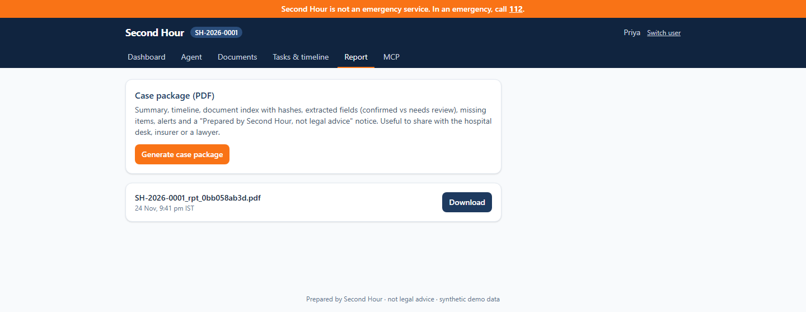
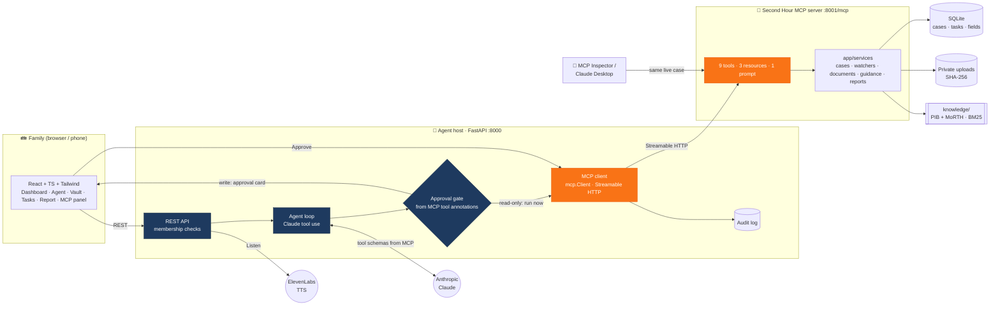
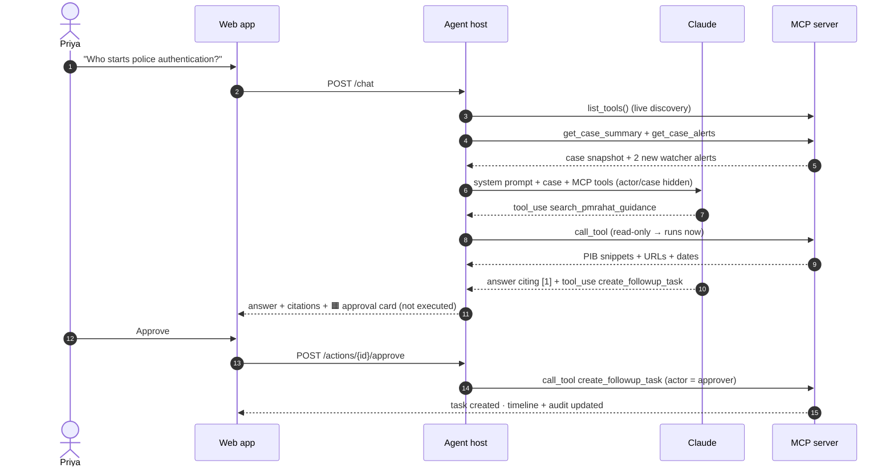

<div align="center">

# 🕑 Second Hour

### The first hour belongs to the doctors. **The second hour belongs to the family.**

**An MCP-powered case coordinator that helps Indian families through PM-RAHAT, hospital desks, police follow-ups and paperwork after a road accident.**

[](#)
[](https://github.com/modelcontextprotocol/python-sdk)
[](https://www.anthropic.com)
[](https://elevenlabs.io)


[**The problem**](#-the-problem) · [**What it does**](#-what-second-hour-does) · [**Screens**](#-a-look-inside) · [**Architecture**](#-architecture) · [**MCP contract**](#-the-mcp-contract) · [**Quick start**](#-quick-start) · [**Demo**](#-90-second-demo-path) · [**Safety**](#-safety-by-design)



</div>

> [!IMPORTANT]
> Second Hour is **not an emergency service**. In an emergency, call **112**. It gives no legal advice and uses **synthetic demo data only**.

---

## 🚨 The problem

Within hours of a road accident, a family has to deal with a cashless government scheme, a hospital billing desk, police paperwork and a pile of documents, all from different people, at the worst possible moment.

<table>
<tr>
<td align="center" width="33%"><h2>₹1.5 lakh</h2>cashless cover per victim under <b>PM-RAHAT</b>, for a <b>maximum of 7 days</b> from the accident<br/><sub><a href="https://www.pib.gov.in/PressReleasePage.aspx?PRID=2238637">PIB, 11 Mar 2026</a></sub></td>
<td align="center" width="33%"><h2>3,674</h2>victims <b>discharged after no police response</b> within the prescribed timelines<br/><sub><a href="https://www.pib.gov.in/PressReleasePage.aspx?PRID=2298285">PIB, 12 Aug 2026</a></sub></td>
<td align="center" width="33%"><h2>22,481</h2>victims covered across <b>34 States/UTs</b> by 31 July 2026<br/><sub><a href="https://www.pib.gov.in/PressReleasePage.aspx?PRID=2298285">PIB, 12 Aug 2026</a></sub></td>
</tr>
</table>

The scheme runs on two clocks: the **7-day / ₹1.5 lakh cover**, and the **hospital → police authentication** step (24h, or 48h if life-threatening). **Families can't see either one.** Scheme rules live in press releases, the TMS/eDAR portals serve hospitals and police rather than families, and generic chatbots guess rules and can't keep track of a case.

## 💡 What Second Hour does

| | Capability | Why it matters |
|---|---|---|
| 🗂️ | **One shared case workspace** | Priya (the coordinator) and Arjun (her brother) see the same live case, tasks and timeline |
| 🧠 | **An agent that remembers the case** | Every chat turn starts from the live case summary and watcher alerts, fetched through MCP |
| 📚 | **Cited answers, official sources only** | PM-RAHAT questions are answered only from curated PIB/MoRTH text, with title, link and date. No match means "I couldn't find it" |
| 📄 | **Document vault** | Bills and reports are classified and fields extracted with confidence scores. **Every field is "Needs review"** until a human confirms it |
| ⏱️ | **Two watchers that run on their own** | Plain code, not LLM guesses: the **cover window** (Day X of 7 and confirmed bills vs ₹1,50,000) and the **police authentication** follow-up (24h/48h) |
| ✅ | **The agent proposes, the family approves** | Create, assign and generate actions become **approval cards**; nothing changes until someone clicks *Approve* |
| 🧾 | **One-click PDF case package** | Summary, timeline, SHA-256 document index, confirmed vs unconfirmed fields, missing items and alerts, marked "not legal advice" |
| 🔊 | **Voice** | ElevenLabs multilingual read-out of agent replies, for a tired or less literate family member |
| 🔌 | **Open through MCP** | The same live case works in our app, **MCP Inspector** or **Claude Desktop** |

## 📸 A look inside

<table>
<tr>
<td width="50%"><b>Agent: cited answers and approval cards</b><br/></td>
<td width="50%"><b>Document vault: every field "Needs review"</b><br/></td>
</tr>
<tr>
<td width="50%"><b>MCP panel: discovered tools and a live audit log</b><br/></td>
<td width="50%"><b>Tasks and timeline: assigned through MCP</b><br/><br/><br/><b>Report</b><br/></td>
</tr>
</table>

## 🏗️ Architecture



### One chat turn, end to end



**Design principles**
- **MCP is the only path to data in chat.** Business logic lives in `app/services/`. The MCP tools and the REST routes call the same functions, so behaviour can't drift between them.
- **Tools are discovered, not hardcoded.** Each turn, the host converts the MCP `inputSchema` into Claude tool definitions.
- **The approval policy comes from MCP annotations.** `readOnlyHint` tools run automatically, and non-idempotent writes need a human. See [`requires_approval()`](app/agent/mcp_client.py).
- **The LLM can't choose who it acts for.** The host injects `actor_id`/`case_id` from the session and strips them from the tool schema shown to Claude. Every tool then re-checks case membership on the server.
- **The watchers are deterministic** ([`get_case_alerts`](app/services/cases.py)) and unit-tested, including the 48h life-threatening case.

More detail is in [docs/ARCHITECTURE.md](docs/ARCHITECTURE.md).

## 🔌 The MCP contract

| # | Tool | Annotation | Approval | What it does |
|---|---|---|:---:|---|
| 1 | `create_accident_case` | write | ✅ | Creates a case; returns `case_id`, `case_number`, `status` |
| 2 | `get_case_summary` | read-only | | Milestones (Day X of 7, cover used, police status), counts, open tasks, alerts, next steps |
| 3 | `search_pmrahat_guidance` | read-only | | BM25 over the curated official corpus; snippets with title, URL and date, or "not found" |
| 4 | `analyze_case_documents` | idempotent write | | Classifies and extracts fields with confidence; saves them as **Needs review** |
| 5 | `get_missing_documents` | read-only | | Present / missing / needs_review against a configurable checklist (guidance) |
| 6 | `get_case_alerts` | read-only | | Deterministic watchers; optional `now` to evaluate at another time |
| 7 | `create_followup_task` | write | ✅ | Creates a task; a due date requires a `due_source` |
| 8 | `assign_family_task` | write | ✅ | Actor **and** assignee must be case members |
| 9 | `generate_case_report` | write | ✅ | Builds the PDF case package; returns a download reference |

**Resources:** `pmrahat://guidance/overview` · `secondhour://cases/{case_id}/timeline` · `secondhour://cases/{case_id}/checklist`
**Prompt:** `accident_case_review`: separate verified facts from unknowns, list missing information and propose next actions, with no side effects unless the user confirms.

<details>
<summary><b>The watcher rules, exactly as coded</b></summary>

| Watcher | Fires when | Suggested task | Source |
|---|---|---|---|
| **Cover window tracker** | `confirmed hospital-bill total ≥ 80% of ₹1,50,000` **or** `day ≥ 6` of 7 | "Ask the hospital billing desk how treatment beyond the cover will be handled" | PIB, 11 Mar 2026 |
| **Police authentication** | family-entered status is `requested_by_hospital` for **> 24h** (**> 48h** if life-threatening) | "Ask the hospital desk for the police authentication status" | PIB, 11 Mar 2026 |

Only **user-confirmed** bill totals count. The police status is labelled **user-provided, unverified**. The alert text says explicitly that the police window is the hospital's and police's process, **not a family deadline**.
</details>

## 🚀 Quick start

**Prerequisites:** Python 3.11+ and Node 20+. An Anthropic key is optional, because an offline agent still runs through MCP. An ElevenLabs key is optional too.

```bash
git clone https://github.com/ALN-web/second-hour.git && cd second-hour

python -m venv .venv
source .venv/bin/activate            # Windows: .venv\Scripts\activate
pip install -r requirements.txt
cp .env.example .env                 # add ANTHROPIC_API_KEY / ELEVENLABS_API_KEY

cd frontend && npm install && cd ..
python -m scripts.seed               # demo users, case SH-2026-0001, synthetic PDFs

./start.sh                           # Windows PowerShell: .\start.ps1 -Seed
```

Open **http://localhost:5173**. As a shortcut, **http://localhost:5173/?as=u_priya&case=case_demo** opens the case directly as Priya.

| Service | URL |
|---|---|
| Web app (dev) | http://localhost:5173 |
| Agent host + built UI | http://localhost:8000 |
| MCP server | http://localhost:8001/mcp |

```bash
python -m pytest -q tests            # 9 tests: MCP discovery, permissions, watchers, RAG
```

### Connect a second MCP host

```bash
npx @modelcontextprotocol/inspector
```

Choose **Streamable HTTP**, enter `http://localhost:8001/mcp` and click Connect. Then call `get_case_alerts` with `{"actor_id":"u_priya","case_id":"case_demo"}`: **the same live case as the web app.** Claude Desktop and other remote-capable hosts can use the same URL; stdio-only hosts can bridge with `npx mcp-remote http://localhost:8001/mcp`.

## 🎬 90-second demo path

1. Log in as **Priya** and open **SH-2026-0001** (Ravi K, Bengaluru, incident last night at 9:30 PM).
2. **Documents** → upload `demo_assets/sample_hospital_bill.pdf`. The fields appear as *Needs review*. **Confirm** the total, ₹1,24,000.
3. **Dashboard** → the cover tracker shows 83%, and a **watcher alert** fires. **Propose task** → **Approve** runs `create_followup_task` through MCP.
4. Set police status to *Requested by hospital*, then **Demo clock +25 h**. The police watcher fires, citing PIB, as *not a family deadline*.
5. **Agent** → *"Who starts police authentication, and is there anything I need to do?"* The answer carries a PIB citation, and **▶ Listen** reads it aloud.
6. **Tasks** → assign to **Arjun**. **Report** → download the PDF.
7. **MCP** tab → the live audit log. Then **MCP Inspector** reads the same case.

The full narrated script is in [VIDEO_SCRIPT.md](VIDEO_SCRIPT.md).

## 🛡️ Safety by design

| Risk | Guardrail |
|---|---|
| Hallucinated scheme rules | Answers **only** from retrieved official text, with citations; otherwise "not found" |
| Wrong extraction from a bill | Every field **Needs review** until confirmed; only confirmed totals feed the watchers |
| Prompt injection in documents | Text PDFs are parsed by **rules, not an LLM**. Vision uses a JSON-only prompt, and tool results are wrapped as untrusted |
| The agent acting on its own | Writes need **human approval**, decided from MCP annotations; every call is **audited** |
| The LLM acting as someone else | `actor_id`/`case_id` are **injected by the host**; membership is checked in every tool and route |
| Over-reliance in an emergency | A permanent **"call 112"** banner; no legal advice, eligibility decisions or compensation predictions |
| Unverified family input | Police status is labelled **user-provided, unverified** everywhere |
| Data exposure | Private `data/uploads/` (never served), SHA-256 hashes, member-only report downloads |

## 🧰 Tech stack

| Layer | Choice | Why |
|---|---|---|
| MCP | Official **MCP Python SDK v2** (`MCPServer`, Streamable HTTP, `mcp.Client`) | The current SDK; one server for our app and any MCP host |
| Agent | **FastAPI** + **Anthropic Claude** tool use, behind a swappable `LLM` interface | Reliable tool use; the model is set by `LLM_MODEL` |
| Data | **SQLite + SQLAlchemy** | Zero setup for the MVP; moves to Postgres/RDS unchanged |
| Documents | **PyMuPDF** rules + **Claude vision** for photos; **ReportLab** PDF | Deterministic where it matters, AI where it helps |
| Retrieval | **rank-bm25** over the paragraphs of `knowledge/` | Small, auditable and citable |
| Voice | **ElevenLabs** `eleven_multilingual_v2` | English, Hindi and Kannada read-out |
| Frontend | **React 19 + TypeScript + Vite + Tailwind v4** | Fast, mobile-first, calm UI |

## 🗂️ Repository map

```
app/
├── mcp_server.py          # MCP server: 9 tools, 3 resources, 1 prompt
├── api.py                 # Agent host: REST, chat, approvals, TTS, MCP panel
├── agent/
│   ├── llm.py             # Swappable LLM interface (Anthropic)
│   ├── mcp_client.py      # MCP client, approval policy, schema conversion, audit
│   └── loop.py            # Agent loop: discovery → Claude → gate → MCP
└── services/              # Business logic shared by MCP and REST
    ├── cases.py           # Cases, tasks, checklist, deterministic watchers
    ├── documents.py       # Upload, SHA-256, classification, extraction
    ├── guidance.py        # BM25 retrieval with citations
    └── reports.py         # PDF case package
knowledge/                 # Curated PIB / MoRTH corpus with front-matter
frontend/                  # React app
scripts/seed.py            # Demo users, case, SAMPLE – SYNTHETIC PDFs
tests/                     # pytest: MCP discovery, permissions, watchers, RAG
docs/                      # Architecture notes and screenshots
```

## 🗺️ Roadmap

- [x] Real MCP server and client, approvals, watchers, cited RAG, document vault, PDF, MCP panel
- [x] ElevenLabs voice read-out
- [ ] Kannada and Hindi UI and answers
- [ ] AWS deployment (App Runner + RDS + S3)
- [ ] OAuth on the MCP server; the actor derived from the token
- [ ] WhatsApp reminders for assigned tasks

The current state and known limitations are in [IMPLEMENTATION_STATUS.md](IMPLEMENTATION_STATUS.md).

## 👥 Team Alpha

| | Name | Role |
|---|---|---|
| 👑 | **Anjankumar LN** | Team leader |
| | **Kanishka S** | Member |
| | **Gagandeep G** | Member |
| | **Deekshith K** | Member |

Built for **wHACKiest 2026** · Track 1: *Make MCP Matter: AI Agents for Everyday Life*

## 📚 Sources

- PIB, 11 March 2026: PM-RAHAT salient features. <https://www.pib.gov.in/PressReleasePage.aspx?PRID=2238637>
- PIB, 12 August 2026: implementation status as of 31 July 2026. <https://www.pib.gov.in/PressReleasePage.aspx?PRID=2298285>
- MoRTH Gazette S.O. 2489(E), 4 June 2025: summarised; only points cross-checked with PIB are included, and the rest is marked *not verified*.

<div align="center"><sub>Synthetic demo data only · Not legal advice · Not an emergency service: call 112</sub></div>
