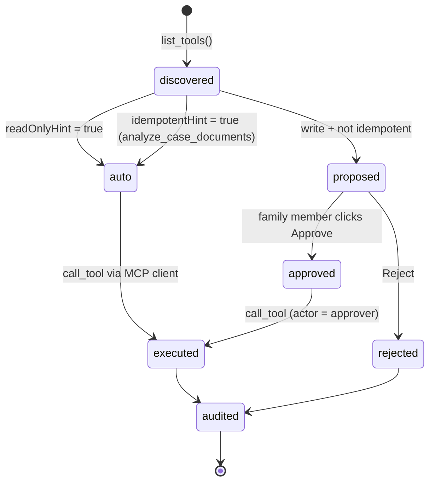
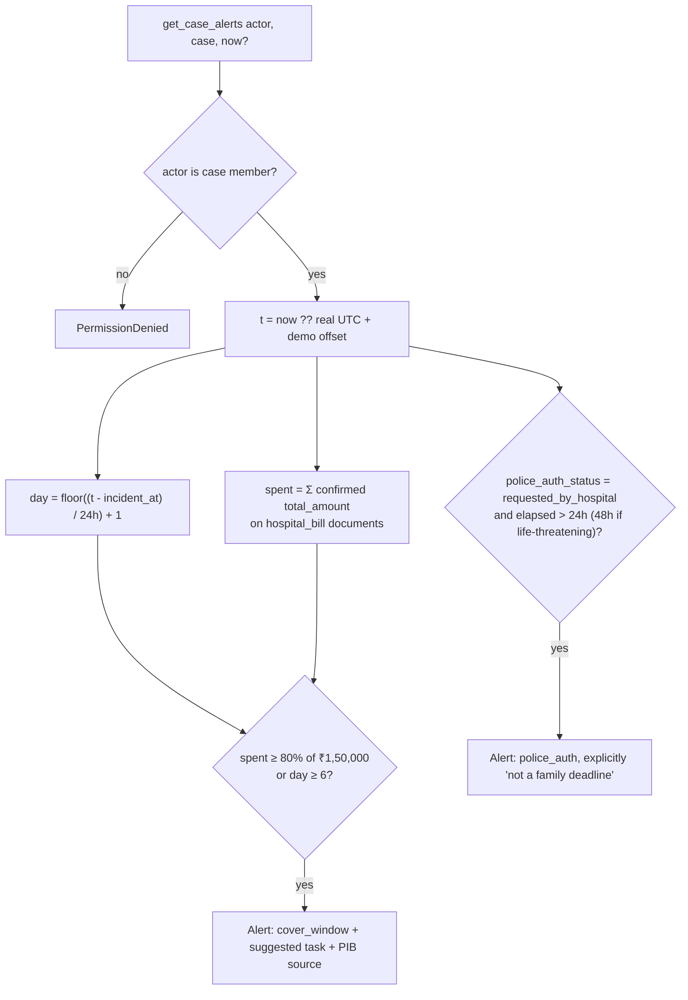
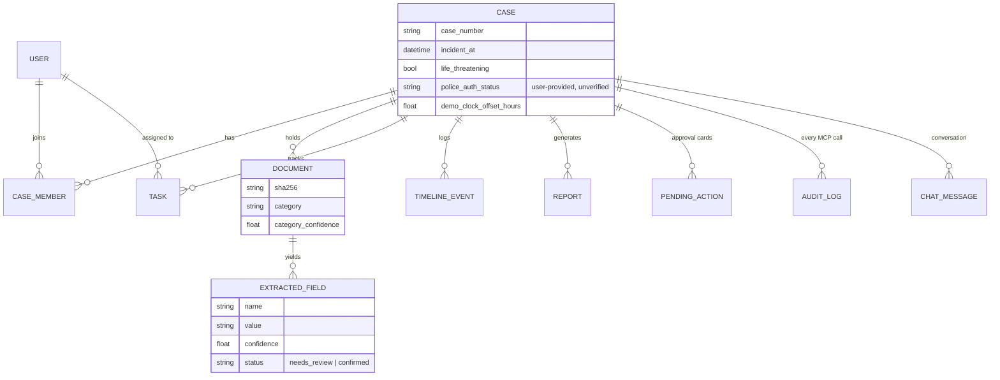

# Second Hour: architecture deep dive

## 1. Components

| Component | Process | Port | Responsibility |
|---|---|---|---|
| **MCP server** (`app/mcp_server.py`) | `python -m app.mcp_server` | 8001 (`/mcp`) | Exposes 9 tools, 3 resources and 1 prompt over Streamable HTTP. Validates input, checks membership and writes timeline events |
| **Agent host** (`app/api.py`, `app/agent/`) | `uvicorn app.api:app` | 8000 | REST for the UI, the agent loop, the approval gate, the audit log and the TTS proxy. Serves the built UI |
| **Services** (`app/services/`) | imported by both | n/a | All business logic. The MCP tools and REST routes call the same functions |
| **Web app** (`frontend/`) | `npm run dev` | 5173 | Dashboard, agent chat, vault, tasks, report and the MCP panel |
| **Storage** | n/a | n/a | SQLite `data/secondhour.db`, private `data/uploads/`, generated `data/reports/` |

## 2. Approval lifecycle

The policy lives in `requires_approval()` in [`app/agent/mcp_client.py`](../app/agent/mcp_client.py). It reads **MCP tool annotations**, not tool names, so a new write tool added to the server is gated automatically.

## 3. Watchers (deterministic)

Covered in `tests/test_core.py`: unconfirmed bills don't trigger alerts, day 6 triggers, and the 23h/25h and 47h/49h boundaries behave correctly.

## 4. Data model

## 5. Retrieval (RAG)

- `knowledge/*.md` files carry front-matter: `title`, `publisher`, `url`, `date`, `last_reviewed` and `verification`.
- Files are split into paragraphs, with the section heading prepended for scoring, and indexed with **BM25Okapi**.
- Results below a score threshold are dropped. If nothing remains, the tool returns `found: false`, and the agent is told to say it couldn't find the answer rather than answer from memory.
- Citations shown in the UI come from the **tool result**, not from the LLM's text, so the model can't make up a source.

## 6. Trust boundaries

| Boundary | Control |
|---|---|
| Browser → host | Demo `X-User-Id`; every route calls `require_member()` |
| LLM → tools | `actor_id`/`case_id` are removed from the schema and injected by the host; writes are approval-gated |
| Host → MCP server | Streamable HTTP on `127.0.0.1`; each tool re-checks membership |
| Uploaded files → system | Size and type allow-list, SHA-256, private storage. Text PDFs are parsed by rules; vision output is JSON-only and always *Needs review* |
| Tool output → LLM | Document analysis results are prefixed `UNTRUSTED DOCUMENT DATA` |

## 7. Moving to production

- Use **OAuth** on the MCP server (the SDK supports it) and derive `actor_id` from the token.
- Move to **Postgres/RDS** and **S3** for uploads with server-side encryption, and run the services on **App Runner/ECS**.
- Make resources per-actor, add rate limiting, and consider PII redaction before LLM calls.
