# Second Hour: Database Relationships & Entity-Relationship Model

This document specifies the entity relationships, cardinality constraints, foreign key cascades, and access control data flows across all Second Hour application modules.

---

## 1. Complete Entity-Relationship Diagram (ERD)

```mermaid
erDiagram
    users ||--o{ user_addresses : "resides_at"
    users ||--o{ emergency_contacts : "designates"
    users ||--o| medical_information : "maintains"
    users ||--o{ medical_access_logs : "subject_of_access"
    users ||--o| user_privacy_preferences : "configures"
    users ||--o| user_notification_preferences : "configures"
    users ||--o{ consent_records : "logs"
    users ||--o{ vehicles : "owns"
    users ||--o{ central_documents : "manages_in_wallet"
    users ||--o{ document_access_logs : "accesses_document"
    users ||--o{ cases : "creates"
    users ||--o{ case_members : "participates_as"
    users ||--o{ conversations : "initiates"

    emergency_contacts ||--|| emergency_contact_permissions : "governed_by"

    vehicles ||--o{ vehicle_photos : "depicted_by"
    vehicles ||--o{ vehicle_insurance_policies : "covered_by_history"
    vehicles ||--o{ case_vehicles : "referenced_in_accident"

    central_documents ||--o{ document_versions : "tracks_revisions"
    central_documents ||--o{ document_access_logs : "accessed_in"
    central_documents ||--o| vehicle_insurance_policies : "referenced_by_policy"

    cases ||--o{ case_members : "includes_members"
    cases ||--o{ case_vehicles : "involves_vehicles"
    cases ||--o{ case_involved_people : "involves_individuals"
    cases ||--o{ case_evidence : "contains_evidence"
    cases ||--o{ case_status_transitions : "records_status_changes"
    cases ||--o{ tasks : "organizes"
    cases ||--o{ timeline_events : "chronicles"
    cases ||--o{ reports : "generates_dossiers"
    cases ||--o{ insurance_claims : "tracks_claims"
    cases ||--o{ external_submissions : "submits_to_authorities"
    cases ||--o{ conversations : "discussed_in"

    case_vehicles ||--o{ case_involved_people : "seated_in"

    reports ||--o{ report_versions : "archives_versions"
    users ||--o{ reports : "approves_or_creates"

    conversations ||--o{ conversation_messages : "contains_turns"
    conversations ||--o{ ai_action_logs : "triggers_actions"

    cases ||--o{ audit_log : "audits"
    users ||--o{ audit_log : "acted_by"
```



---

## 2. Foreign Key & Cascade Deletion Matrix

| Parent Table | Child Table | Foreign Key Column | On Delete Action | Rationale |
|---|---|---|---|---|
| `users` | `user_addresses` | `user_id` | **CASCADE** | Address lifecycle is strictly bound to user existence. |
| `users` | `emergency_contacts` | `user_id` | **CASCADE** | Contacts belong exclusively to the designating user. |
| `emergency_contacts` | `emergency_contact_permissions` | `contact_id` | **CASCADE** | Permissions cannot exist without the parent contact. |
| `users` | `medical_information` | `user_id` | **CASCADE** | User removal wipes quarantined medical information. |
| `users` | `medical_access_logs` | `user_id` | **CASCADE** | Access logs tied to subject user profile. |
| `users` | `medical_access_logs` | `actor_id` | **RESTRICT** | Retains audit record of who inspected medical data. |
| `users` | `user_privacy_preferences` | `user_id` | **CASCADE** | User-specific data governance settings. |
| `users` | `user_notification_preferences` | `user_id` | **CASCADE** | User-specific channel subscriptions. |
| `users` | `consent_records` | `user_id` | **CASCADE** | User consent history bound to user account. |
| `users` | `vehicles` | `user_id` | **CASCADE** | Registered vehicle profile deleted with user account. |
| `vehicles` | `vehicle_photos` | `vehicle_id` | **CASCADE** | Vehicle photos removed when vehicle profile is deleted. |
| `vehicles` | `vehicle_insurance_policies` | `vehicle_id` | **CASCADE** | Insurance policies tied to vehicle lifecycle. |
| `vehicle_insurance_policies` | `vehicle_insurance_policies` | `superseded_by_policy_id` | **SET NULL** | Retains historical policy lineage if superseding policy is removed. |
| `users` | `central_documents` | `user_id` | **CASCADE** | User owns document wallet entries. |
| `central_documents` | `document_versions` | `document_id` | **CASCADE** | Revisions belong to parent wallet document. |
| `central_documents` | `document_access_logs` | `document_id` | **CASCADE** | Document view/download audit logs tied to document. |
| `users` | `document_access_logs` | `actor_id` | **RESTRICT** | Preserves identity of actor who accessed document. |
| `central_documents` | `vehicle_insurance_policies` | `document_id` | **SET NULL** | Retains policy metadata if underlying document is detached. |
| `users` | `cases` | `created_by` | **RESTRICT** | Accident cases are statutory records; deletion blocked if open cases exist. |
| `cases` | `case_members` | `case_id` | **CASCADE** | Member workspace permissions deleted with case. |
| `users` | `case_members` | `user_id` | **CASCADE** | Removes member association on user deletion. |
| `cases` | `case_vehicles` | `case_id` | **CASCADE** | Multi-vehicle case records belong to incident workspace. |
| `vehicles` | `case_vehicles` | `vehicle_id` | **SET NULL** | Preserves accident case vehicle record even if user deletes registered car. |
| `cases` | `case_involved_people` | `case_id` | **CASCADE** | Involved people records tied to case. |
| `case_vehicles` | `case_involved_people` | `case_vehicle_id` | **SET NULL** | Preserves victim record even if vehicle entry is modified. |
| `cases` | `case_evidence` | `case_id` | **CASCADE** | Incident scene evidence bound to case workspace. |
| `cases` | `case_status_transitions` | `case_id` | **CASCADE** | Audit transitions tied to case. |
| `cases` | `tasks` | `case_id` | **CASCADE** | Actionable checklist items tied to case. |
| `users` | `tasks` | `assignee_id` | **SET NULL** | Tasks remain open if assignee user is removed. |
| `cases` | `timeline_events` | `case_id` | **CASCADE** | Activity timeline deleted with case. |
| `cases` | `reports` | `case_id` | **CASCADE** | Formal dossiers deleted with case. |
| `reports` | `report_versions` | `report_id` | **CASCADE** | Versioned PDFs removed with report envelope. |
| `cases` | `insurance_claims` | `case_id` | **CASCADE** | Motor claims belong to accident workspace. |
| `cases` | `external_submissions` | `case_id` | **CASCADE** | Outbound statutory filings belong to case. |
| `users` | `conversations` | `user_id` | **CASCADE** | AI chat histories belong to user account. |
| `cases` | `conversations` | `case_id` | **SET NULL** | Chat remains if case association is unlinked. |
| `conversations` | `conversation_messages` | `conversation_id` | **CASCADE** | Chat turns deleted with conversation. |
| `cases` | `ai_action_logs` | `case_id` | **CASCADE** | Action proposals belong to case workspace. |
| `cases` | `audit_log` | `case_id` | **SET NULL** | System audit logs remain permanent for compliance. |

---

## 3. Privacy, Storage & Governance Data Flows

### 3.1 Strict Separation: Notification vs. Workspace Access
```
User Profile
    │
    ▼ (1:N)
emergency_contacts (Priority, Relationship, Mobile, Alternate)
    │
    ▼ (1:1 Mandatory Constraint)
emergency_contact_permissions
    ├── Notification Dispatch Layer (Outbound Only)
    │     ├── can_notify_accident_sos: TRUE     ──> Dispatches instant SOS alerts
    │     ├── can_receive_case_sms: TRUE        ──> Sends high-level status SMS
    │     └── can_receive_whatsapp_updates: FALSE ──> Opt-in WhatsApp digests
    │
    └── Interactive Workspace Layer (Requires Explicit Enablement)
          ├── has_workspace_access: FALSE       ──> Default NO account login
          ├── permitted_case_ids: ["case_..."] ──> Scoped to explicit incidents
          ├── workspace_role: 'viewer'          ──> Read-only or Editor
          ├── can_view_medical: FALSE           ──> ZERO medical exposure
          └── can_view_documents: FALSE         ──> ZERO wallet document exposure
```

### 3.2 Document Access & Purpose-Specific Medical Audit
```
User / Contact / Insurer Requests Document Access
    │
    ▼
Check Permission Gate (Owner OR Explicit Case Member Permission)
    │
    ├── Access Denied ──> 403 Forbidden
    │
    └── Access Granted
          │
          ├── 1. Generate short-lived pre-signed URL (15 min TTL) from StorageAdapter
          │
          └── 2. Append immutable record to document_access_logs
                   ├── document_id
                   ├── actor_id
                   ├── action ('download_file' | 'presigned_url_generated')
                   ├── purpose ('claim_intake' | 'user_download')
                   └── timestamp & client IP
```

### 3.3 Historical Insurance Lineage
```
vehicles (KA-01-MJ-2024)
    │
    ├── (v1) vehicle_insurance_policies (POL-2024)
    │          ├── is_current_policy: FALSE
    │          ├── policy_status: 'renewed'
    │          └── superseded_by_policy_id: 'vpol_2025'
    │
    └── (v2) vehicle_insurance_policies (POL-2025)
               ├── is_current_policy: TRUE
               ├── policy_status: 'active'
               └── document_id: 'cdoc_insurance_2025' (Wallet Ref)
```
*Rule:* Insurance coverage history is preserved forever for claim audits and historical dispute defense.

### 3.4 Multi-Vehicle & Multi-Victim Incident Normalization
```
cases (Incident metadata, GPS Coordinates, Hospital Triage)
    │
    ├─── (1:N) ──> case_vehicles
    │                 ├── Vehicle A (Primary Insured: links to vehicles.id)
    │                 └── Vehicle B (Third-Party: registration_number, driver, insurer)
    │
    └─── (1:N) ──> case_involved_people
                      ├── Person 1 (Driver: links to Vehicle A, uninjured)
                      ├── Person 2 (Passenger: links to Vehicle A, injured -> General Ward)
                      └── Person 3 (Pedestrian: injured -> Trauma Unit)
```

### 3.5 Supervised AI Execution, Reports Approval & External Submissions
```
Ask Second Hour AI
    │
    ▼ (Generates draft police statement or report)
reports (status='draft')
    │
    ▼ (v1 PDF written to StorageAdapter)
report_versions (v1 PDF, SHA-256)
    │
    ▼ (Human Coordinator Reviews on /cases/:id)
User clicks [Approve Report]
    │
    ├── reports.status = 'approved'
    ├── reports.approved_by = 'u_priya'
    └── reports.approved_at = NOW()
          │
          ▼ (Coordinator initiates PM-RAHAT / Police portal filing)
       external_submissions (status='queued' -> 'submitted' -> 'acknowledged')
          └── External reference stored ONLY upon confirmed receipt
```
