# Second Hour: Database Relationships & Entity-Relationship Model

This document specifies the entity relationships, cardinality constraints, foreign key cascades, and data flow interactions across all Second Hour application modules.

---

## 1. Entity-Relationship Diagram (ERD)

```mermaid
erDiagram
    users ||--o{ user_addresses : "resides_at"
    users ||--o{ emergency_contacts : "designates"
    users ||--o| medical_information : "maintains"
    users ||--o| user_privacy_preferences : "configures"
    users ||--o| user_notification_preferences : "configures"
    users ||--o{ consent_records : "logs"
    users ||--o{ vehicles : "owns"
    users ||--o{ central_documents : "manages_in_wallet"
    users ||--o{ cases : "creates"
    users ||--o{ case_members : "participates_as"
    users ||--o{ conversations : "initiates"

    emergency_contacts ||--|| emergency_contact_permissions : "governed_by"

    vehicles ||--o{ vehicle_photos : "depicted_by"
    vehicles ||--o{ vehicle_insurance_policies : "covered_by"
    vehicles ||--o{ case_vehicles : "referenced_in_accident"

    central_documents ||--o{ document_versions : "tracks_revisions"
    central_documents ||--o| vehicle_insurance_policies : "referenced_by_policy"

    cases ||--o{ case_members : "includes_members"
    cases ||--o{ case_vehicles : "involves_vehicles"
    cases ||--o{ case_involved_people : "involves_individuals"
    cases ||--o{ case_evidence : "contains_evidence"
    cases ||--o{ case_status_transitions : "records_status_changes"
    cases ||--o{ tasks : "organizes"
    cases ||--o{ timeline_events : "chronicles"
    cases ||--o{ reports : "generates_dossiers"
    cases ||--o{ insurance_claims : "tracks_claims"
    cases ||--o{ external_submissions : "submits_to_authorities"
    cases ||--o{ conversations : "discussed_in"

    case_vehicles ||--o{ case_involved_people : "seated_in"

    reports ||--o{ report_versions : "archives_versions"
    users ||--o{ reports : "approves_or_creates"

    conversations ||--o{ conversation_messages : "contains_turns"
    conversations ||--o{ ai_action_logs : "triggers_actions"

    cases ||--o{ audit_log : "audits"
    users ||--o{ audit_log : "acted_by"
```



---

## 2. Foreign Key & Cascade Deletion Matrix

| Parent Table | Child Table | Foreign Key Column | On Delete Action | Rationale |
|---|---|---|---|---|
| `users` | `user_addresses` | `user_id` | **CASCADE** | Address lifecycle is strictly bound to user existence. |
| `users` | `emergency_contacts` | `user_id` | **CASCADE** | Contacts belong exclusively to the designating user. |
| `emergency_contacts` | `emergency_contact_permissions` | `contact_id` | **CASCADE** | Permissions cannot exist without the parent contact. |
| `users` | `medical_information` | `user_id` | **CASCADE** | User removal wipes quarantined medical information. |
| `users` | `user_privacy_preferences` | `user_id` | **CASCADE** | User-specific data governance settings. |
| `users` | `user_notification_preferences` | `user_id` | **CASCADE** | User-specific channel subscriptions. |
| `users` | `vehicles` | `user_id` | **CASCADE** | Registered vehicle profile deleted with user account. |
| `vehicles` | `vehicle_photos` | `vehicle_id` | **CASCADE** | Vehicle photos removed when vehicle profile is deleted. |
| `vehicles` | `vehicle_insurance_policies` | `vehicle_id` | **CASCADE** | Insurance policies tied to vehicle lifecycle. |
| `users` | `central_documents` | `user_id` | **CASCADE** | User owns document wallet entries. |
| `central_documents` | `document_versions` | `document_id` | **CASCADE** | Revisions belong to parent wallet document. |
| `central_documents` | `vehicle_insurance_policies` | `document_id` | **SET NULL** | Retains insurance policy metadata if underlying document is detached. |
| `users` | `cases` | `created_by` | **RESTRICT** | Accident cases are statutory records; deletion blocked if open cases exist. |
| `cases` | `case_members` | `case_id` | **CASCADE** | Member workspace permissions deleted with case. |
| `users` | `case_members` | `user_id` | **CASCADE** | Removes member association on user deletion. |
| `cases` | `case_vehicles` | `case_id` | **CASCADE** | Multi-vehicle case records belong to incident workspace. |
| `vehicles` | `case_vehicles` | `vehicle_id` | **SET NULL** | Preserves accident case vehicle record even if user deletes registered car. |
| `cases` | `case_involved_people` | `case_id` | **CASCADE** | Involved people records tied to case. |
| `case_vehicles` | `case_involved_people` | `case_vehicle_id` | **SET NULL** | Preserves victim record even if vehicle entry is modified. |
| `cases` | `case_evidence` | `case_id` | **CASCADE** | Incident scene evidence bound to case workspace. |
| `cases` | `case_status_transitions` | `case_id` | **CASCADE** | Audit transitions tied to case. |
| `cases` | `tasks` | `case_id` | **CASCADE** | Actionable checklist items tied to case. |
| `users` | `tasks` | `assignee_id` | **SET NULL** | Tasks remain open if assignee user is removed. |
| `cases` | `timeline_events` | `case_id` | **CASCADE** | Activity timeline deleted with case. |
| `cases` | `reports` | `case_id` | **CASCADE** | Formal dossiers deleted with case. |
| `reports` | `report_versions` | `report_id` | **CASCADE** | Versioned PDFs removed with report envelope. |
| `cases` | `insurance_claims` | `case_id` | **CASCADE** | Motor claims belong to accident workspace. |
| `cases` | `external_submissions` | `case_id` | **CASCADE** | Outbound statutory filings belong to case. |
| `users` | `conversations` | `user_id` | **CASCADE** | AI chat histories belong to user account. |
| `cases` | `conversations` | `case_id` | **SET NULL** | Chat remains if case association is unlinked. |
| `conversations` | `conversation_messages` | `conversation_id` | **CASCADE** | Chat turns deleted with conversation. |
| `cases` | `ai_action_logs` | `case_id` | **CASCADE** | Action proposals belong to case workspace. |
| `cases` | `audit_log` | `case_id` | **SET NULL** | System audit logs remain permanent for compliance. |

---

## 3. Cross-Module Data Flows

### 3.1 Emergency Contact Permission Enforcement
```
User Profile
    │
    ▼ (1:N)
emergency_contacts (Priority, Phone, Relationship)
    │
    ▼ (1:1 Mandatory Constraint)
emergency_contact_permissions
    ├── can_notify_accident: TRUE   ──> Trigger SOS dispatch
    ├── can_receive_case_updates: TRUE ──> Send WhatsApp/SMS summaries
    ├── can_access_case: TRUE       ──> Grant entry to case_members
    ├── can_view_medical: FALSE     ──> Strict mask on medical_information
    └── can_view_documents: FALSE   ──> Strict mask on central_documents
```
*Rule:* Emergency contacts **never** receive document or medical access by default. Explicit boolean gates must be granted by the primary user.

### 3.2 Centralized Document Wallet (Zero Duplication)
```
central_documents (Unique storage_key in Object Storage)
    ▲                        ▲                        ▲
    │ resource_type='USER'   │ resource_type='VEHICLE'│ resource_type='ACCIDENT_CASE'
    │                        │                        │
Profile Wallet        Registered Vehicles      Accident Case Workspace
(Aadhaar, DL)         (RC, Insurance, PUC)     (FIR, Hospital Bills, MLC)
```
*Rule:* Vehicle registration certificates, insurance policy PDFs, and accident bills do not replicate binary files. They reference `central_documents.id` with role-based visibility.

### 3.3 Multi-Vehicle & Multi-Victim Incident Normalization
```
cases (Incident metadata, Location, PM-RAHAT flags)
    │
    ├─── (1:N) ──> case_vehicles
    │                 ├── Vehicle A (Primary Insured: links to vehicles.id)
    │                 └── Vehicle B (Third-Party: registration_number, driver)
    │
    └─── (1:N) ──> case_involved_people
                      ├── Person 1 (Driver: links to Vehicle A)
                      ├── Person 2 (Passenger: links to Vehicle A, injured)
                      └── Person 3 (Pedestrian: injured, links to Sample Hospital)
```
*Rule:* Replaces single-vehicle string fields with relational entities, supporting complex collisions, multiple casualties, and third-party insurer tracking.

### 3.4 Report Generation & Human Approval Lifecycle
```
AI / System Assistant
    │
    ▼
reports (status='draft')
    │
    ▼
report_versions (v1 PDF generated in Object Storage)
    │
    ▼
User Review in Frontend (/cases/:id)
    ├── [Approve] ──> status='approved', approved_by=user_id, approved_at=NOW()
    │                    │
    │                    └── Ready for external submission / insurance download
    │
    └── [Reject/Edit] ──> status='draft', trigger v2 generation
```
*Rule:* No report or statement is marked final, submitted, or shared with authorities without human confirmation.

### 3.5 Supervised AI Execution & Audit Trail
```
User Query in Ask Second Hour AI
    │
    ▼
conversation_messages (User prompt)
    │
    ▼
Assistant Tool Invocation (e.g., generate_police_draft)
    │
    ├── Read-Only Tool ──> Immediate execution -> citations_json logged
    │
    └── Mutating Tool ──> ai_action_logs (requires_approval=TRUE, approval_status='proposed')
                             │
                             ▼
                          User clicks [Approve Action]
                             │
                             ▼
                          Executed -> audit_log (immutable write)
```
