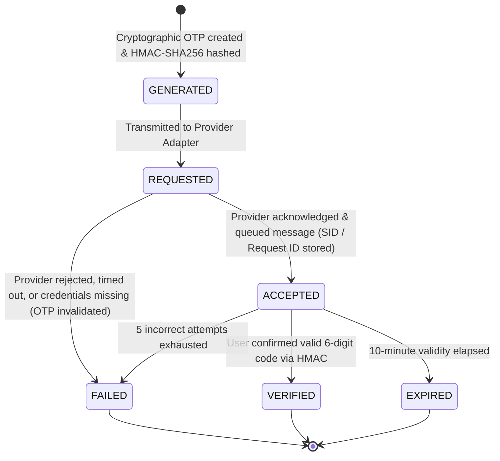

# Second Hour — OTP Delivery Architecture & Configuration Guide

This document provides a comprehensive operational and architectural guide for email and SMS OTP delivery in Second Hour.

---

## 1. Pipeline Architecture & Delivery States

Second Hour implements a multi-provider, fail-closed delivery pipeline for two-factor contact verification (`email_verify`, `phone_verify`, `step_up`, `email_change`, `phone_change`).

### Delivery Lifecycle State Machine



### Provider Acceptance vs. Handset Delivery
In accordance with telecommunications reality, **provider acceptance** (`ACCEPTED`) indicates the external gateway acknowledged and queued the message for transit. It is strictly distinguished from confirmed handset delivery, which depends on carrier networks, DLT routing, and device availability.

---

## 2. Supported Email Providers

Second Hour supports standard SMTP and modern REST API delivery.

### 2.1 SMTP Delivery Adapter (`SmtpEmailAdapter`)
- Standard library implementation with `STARTTLS` and `SSL`.
- Compatible with all standard enterprise email relays:
  - **SendGrid**: `smtp.sendgrid.net`, Port 587, User `apikey`
  - **Amazon SES**: `email-smtp.ap-south-1.amazonaws.com`, Port 587
  - **Brevo (Sendinblue)**: `smtp-relay.brevo.com`, Port 587
  - **Postmark**: `smtp.postmarkapp.com`, Port 587
  - **Mailgun**: `smtp.mailgun.org`, Port 587
  - **Google Workspace / Gmail SMTP**: `smtp.gmail.com`, Port 587 (App Password required)

### 2.2 Resend REST API (`ResendEmailAdapter`)
- Fast HTTP REST API using `httpx`.
- Configured via `RESEND_API_KEY` and `RESEND_FROM_EMAIL`.

### 2.3 Email Template Features
- Clean branded layout with Second Hour palette (`#091528` navy and `#ff7518` safety orange).
- High-contrast, letter-spaced monospace 6-digit passcode.
- Prominent 10-minute expiration notice.
- Prominent security warning: *"Never share this code with anyone. Second Hour representatives will never ask for your verification code."*
- Multipart MIME (`text/plain` fallback and responsive `text/html`).

---

## 3. Supported SMS Gateways

### 3.1 Twilio SMS Gateway (`TwilioSmsAdapter`)
- Global SMS delivery with E.164 normalization.
- Uses Twilio REST API with HTTP Basic Auth.
- Configurable with either a dedicated phone number (`TWILIO_FROM_NUMBER`) or Messaging Service (`TWILIO_MESSAGING_SERVICE_SID`).
- Captures unique message `sid` (e.g. `SMxxxxxxxxxxxxxxxxxxxxxxxxxxxxxxxx`).

### 3.2 MSG91 Gateway (India TRAI DLT Compliant)
- Native Indian telecom routing compliant with Telecom Commercial Communications Customer Preference Regulations (TCCCPR, 2018).
- Dispatches to MSG91 OTP API (`https://control.msg91.com/api/v5/otp`).
- Captures provider `request_id`.

#### TRAI DLT Compliance Requirements (India)
To send transactional SMS within India, TRAI mandates Distributed Ledger Technology (DLT) registration. Follow these steps prior to production deployment:

1. **Principal Entity (PE) Registration**:
   - Register the business entity on any telecom operator DLT portal (e.g., [Jio DLT](https://trueconnect.jio.com/), [Airtel DLT](https://www.airtel.in/business/commercial-communication), or [Vilpower](https://www.vilpower.in/)).
   - Obtain an approved **Principal Entity ID** (`MSG91_DLT_TE_ID`).
2. **Sender ID / Header Registration**:
   - Register a 6-character alphabetic sender header (e.g. `SECHOR`).
   - Set as `MSG91_SENDER_ID`.
3. **Content Template Registration (Service Implicit)**:
   - Register an OTP template under category **Service Implicit**.
   - Example Template Text:
     ```text
     Your Second Hour verification code is {#var#}. Valid for 10 minutes. Do not share this code with anyone. - Second Hour
     ```
   - Obtain the approved **DLT Template ID** and set as `MSG91_TEMPLATE_ID`.

---

## 4. Indian Mobile Number Normalization

The system automatically validates and canonicalizes Indian mobile numbers into standard E.164 (`+91XXXXXXXXXX`):

| Input Format | Normalized Output | Status |
|---|---|---|
| `9876543210` | `+919876543210` | Valid (10 digits starting with 6-9) |
| `09876543210` | `+919876543210` | Valid (leading 0 stripped) |
| `919876543210` | `+919876543210` | Valid (12 digits with 91 prefix) |
| `+91 98765-43210`| `+919876543210` | Valid (spaces and punctuation stripped) |
| `5123456789` | Rejected (`ValueError`) | Invalid (Indian mobiles start with 6, 7, 8, or 9) |
| `12345` | Rejected (`ValueError`) | Invalid (insufficient digits) |

---

## 5. Environment Variables Reference

Add the following to `.env` (refer to `.env.example`):

```ini
# ==============================================================================
# Email OTP Delivery Configuration
# ==============================================================================
EMAIL_PROVIDER=SMTP                  # SMTP | RESEND | MOCK (dev only)
SMTP_HOST=smtp.sendgrid.net         # SMTP server hostname
SMTP_PORT=587                       # 587 (TLS) or 465 (SSL)
SMTP_USERNAME=apikey                # SMTP authentication user
SMTP_PASSWORD=your_smtp_key_here    # SMTP password or API token
SMTP_USE_TLS=true                   # Enable STARTTLS (default: true)
SMTP_USE_SSL=false                  # Direct SSL connection (port 465)
SMTP_FROM_EMAIL=no-reply@secondhour.in
SMTP_FROM_NAME=Second Hour
SMTP_TIMEOUT_SECONDS=10.0

# Optional Resend configuration:
RESEND_API_KEY=
RESEND_FROM_EMAIL=no-reply@secondhour.in

# ==============================================================================
# SMS OTP Delivery Configuration
# ==============================================================================
SMS_PROVIDER=TWILIO                 # TWILIO | MSG91 | MOCK (dev only)
SMS_TIMEOUT_SECONDS=10.0

# Twilio Configuration:
TWILIO_ACCOUNT_SID=ACxxxxxxxxxxxxxxxxxxxxxxxxxxxxxxxx
TWILIO_AUTH_TOKEN=your_auth_token_here
TWILIO_FROM_NUMBER=+15005550006
TWILIO_MESSAGING_SERVICE_SID=

# MSG91 Configuration (India TRAI DLT):
MSG91_AUTH_KEY=your_msg91_auth_key
MSG91_TEMPLATE_ID=your_dlt_template_id
MSG91_SENDER_ID=SECHOR
MSG91_DLT_TE_ID=your_telecom_entity_id
MSG91_OTP_URL=https://control.msg91.com/api/v5/otp
```

---

## 6. Security & Audit Rules

1. **Fail-Closed on Missing Credentials**:
   - In staging and production environments, missing delivery credentials abort delivery immediately and report a safe error.
   - `MOCK` provider is strictly forbidden in production (`RuntimeError` on startup).
2. **Immediate OTP Invalidation upon Delivery Failure**:
   - If a provider rejects a message or times out, the generated OTP is marked `DELIVERY_FAILED` and `is_used = True`. An undelivered code can never be verified.
3. **Zero Secret Logging**:
   - The 6-digit passcode is NEVER written to server logs, database text fields, or exception traces.
   - Target identifiers are masked in all logs (e.g. `p***a@example.com`, `+9****3210`).
4. **Keyed HMAC-SHA256 Storage**:
   - Plaintext OTPs are never stored in the database. Only keyed HMAC-SHA256 hashes bound to `(user_id, channel, purpose, salt)` are persisted.
5. **Rate Limiting & Cooldown**:
   - 60-second resend cooldown enforced with row locking.
   - 5-attempt brute force lockout.
   - 10-minute expiry window.

---

## 7. Testing & Verification

Run the dedicated OTP delivery test suite:

```bash
python -m pytest tests/test_otp_delivery.py -v
```

All 20 test cases verify adapter mechanics, provider mocks, failure recovery, phone normalization, and security boundaries.
