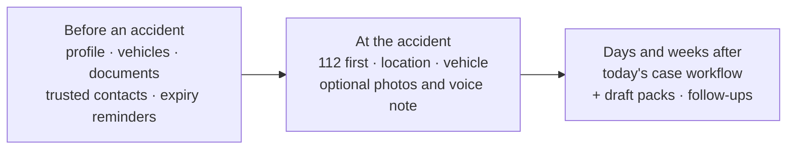

# Second Hour v2: "Prepare once"

> **Prepare once. Respond in seconds. Stay supported until the case is resolved.**

Today Second Hour helps a family **after** a road accident. v2 starts **before** one. A readiness profile means nobody retypes details in a crisis, and everyday reminders give families a reason to use the app on normal days.

This is a plan, not shipped code. The current prototype is described in the [README](../README.md).

## The three phases

| Phase | The user | Second Hour |
|---|---|---|
| Before | Adds profile, vehicles, insurance, PUC, trusted contacts and what each may do | Keeps a document wallet; reminds about insurance and PUC expiry using fixed rules |
| At the accident | Taps 112 first, then "Report an accident" with location, vehicle, and optional photos or a voice note | Fills in everything else from the profile. A trusted contact can start the case if the victim can't, and every access is logged |
| After | Approves tasks and drafts | Runs the existing watchers, cited guidance, vault, tasks and report. Adds hospital, police-information and insurance draft packs, plus follow-up reminders and escalation |

## What goes into the next version and what waits

| Feature | Next version | Later | Notes |
|---|---|---|---|
| Readiness profile, vehicles, document wallet | ✅ | | Every field shows where it came from: typed, extracted, confirmed or verified |
| Trusted contacts with permissions (Owner, Delegate, Viewer) | ✅ | | Revocable; the owner is notified when someone accesses their data |
| Insurance and PUC expiry reminders | ✅ | | Deterministic |
| Minimal accident intake | ✅ | | 112 is never behind a form |
| Hospital, police-information and insurance draft packs | ✅ | | Editable, missing fields marked, human approval, download only |
| Follow-up reminders and escalation | ✅ | | Configurable checkpoints, not legal deadlines |
| Kannada and Hindi (text and voice) | ✅ | | |
| Emergency QR card | | ✅ | Revocable token, no personal data in the code |
| Photo damage description | | ✅ | Description only, never injury severity |
| MACT document organiser | | ✅ | Checklist only; no payout calculator |
| DigiLocker, eDAR, TMS 2.0, ERSS, insurer integrations | | Only with authorised access | Adapter interfaces plus manual fallback |

## What does not change

- **MCP stays the backbone.** Every new feature is a new MCP tool, resource or prompt.
- **Approvals still come from tool annotations**, so new write tools are gated automatically.
- **Fixed rules** handle anything to do with time or money; the LLM only explains.
- **Official facts only**, with citations. Anything unverified is labelled.
- **No official submissions, eligibility decisions, diagnoses or legal advice.**

## Likely new MCP tools

| Tool | Type | Approval |
|---|---|---|
| `get_readiness_status` | read-only | auto |
| `add_vehicle` / `update_vehicle` | write | yes |
| `get_expiring_documents` | read-only | auto |
| `start_case_from_profile` | write | yes (or a pre-authorised Delegate) |
| `draft_recipient_pack` (hospital / police information / insurance) | write | yes |
| `schedule_followups` | write | yes |

## Technology direction

Keep the current stack: FastAPI, the MCP Python SDK, SQLAlchemy, React, Claude behind the swappable LLM interface, ElevenLabs and BM25. The planned changes are:

- SQLite → **PostgreSQL**
- Local files → **S3** with encryption and short-lived signed URLs
- A database-backed **job table** for reminders, instead of adding Celery or Redis early
- **Phone OTP login**, plus **OAuth on the MCP server**
- Design aligned with India's **DPDP Act, 2023**: consent, purpose limitation and deletion rights
